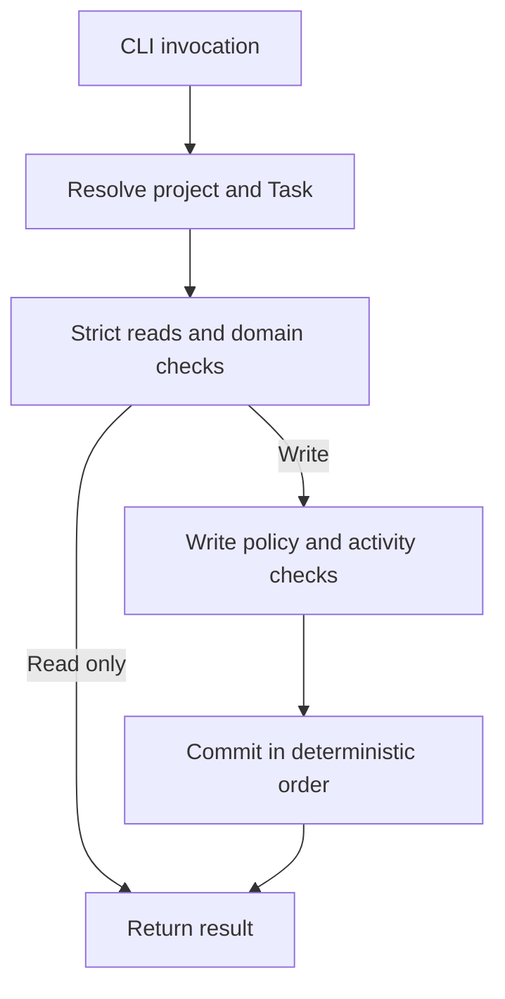

# System architecture

[简体中文](./system.zh.md)

## Product definition

tk is a persistent Task runtime for local projects.

tk stores state in project files. It does not create a database, global Task registry, background index, remote service, or resident daemon. It does not manage priorities, scheduling, boards, Issue mirroring, Agent orchestration, or session binding.

## System components

The system consists of the following parts:

- Rust runtime: owns Task domain rules, persistence, schema migration, project discovery, the CLI, and Skill lifecycle. It does not run Harness sessions or model calls.
- Skill variants: `tk-cli` and `tk-cli-zh` provide self-contained instructions for activation, authorization, Task use, and material maintenance. They do not enforce runtime invariants or install components.
- Public documentation: explains implementation and provides independently usable user references to the specified product contract. Specifications contain complete requirements and acceptance. Review history and local Task materials remain separate.
- ADR: responsible for long-term architectural decisions and their rationale. Not responsible for implementation progress and test logs.

One Cargo package builds one `tk` executable. Each command exits after execution and rereads canonical state on its next invocation.

## Harness boundary

A Harness is the software environment around a model that enables it to operate as an Agent. Codex, Claude Code, Pi, and OMP have known ordinary Skill roots. Other environments can select a custom root.

The Harness is responsible for:

- loading the Skill;
- providing the session working directory and available model information;
- executing CLI commands and presenting their results.

The Rust runtime is responsible for:

- parsing and validating Tasks;
- enforcing lifecycle, relationship, migration, and path rules;
- reading and writing project state and the WAL;
- installing, updating, and uninstalling CLI Skills.

Task domain rules and runtime compatibility remain in Rust.

## Distribution boundary

`projects/tk/` contains one Rust runtime, two self-contained Skills, and public documentation. Each Skill is a complete source tree and distribution unit with internal file references only.

Cargo collects both Skill trees and writes one deterministic archive and manifest in `OUT_DIR`, then embeds them in the executable. Installation reads only these embedded artifacts.

## Task operation flow

## Skill lifecycle

Select an ordinary Skill root, validate the embedded distribution and managed targets, then write the selected language and remove the other. Uninstall removes the two managed Skill directories completely. Both operations preserve the root and all unrelated content, without reading Harness configuration or invoking host commands.

## Invariants at the system level

1. UUIDv7 is the authoritative identity of a Task. Names describe Tasks, and paths locate them.
2. The only Task states are `planning`, `open`, and `closed`.
3. A project selects one Task root directory and one metadata representation.
4. split and embed are both fully supported representations. Neither is temporary or secondary.
5. Normal reads and writes accept only the current schema. Formally released older schemas are upgraded through stepwise migrators.
6. Ordinary writes do not use locks, leases, compare-and-swap, or automatic merging.
7. Single-file updates use atomic replacement. Multi-target operations complete all prechecks before committing in deterministic order.
8. If a multi-target write fails partway through, it stops and reports completed and incomplete items. It does not roll back automatically.
9. No domain operation state remains after the process for a multi-target operation exits. Subsequent calls reread the current canonical state.
10. GC deletes only temporary content created by tk and identified by the minimal cleanup manifest.
11. All Task project relationships remain within the same Task root directory.
12. Skill installation does not access the network, read Task projects, or run Git policy checks.
13. Installation and removal manage only `tk-cli` and `tk-cli-zh` directly below the selected root. Install may create missing parents. Neither operation maintains installation history.
14. Public documentation describes the current formal contract.

## Platform boundary

The current implementation and automation target Linux. Paths, executable bits, process identity, and Harness user-level locations follow Linux behavior.

The runtime uses the fixed user-level path `$HOME/.local/bin/tk`. Component lifecycle commands must not install another runtime copy, wrapper, or parallel version.
