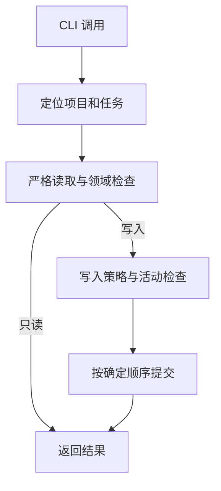

# 系统架构

[English](./system.md)

## 产品定义

tk 是一个面向本地项目的持久任务运行时。

tk 使用项目文件保存状态，不建立数据库、全局任务注册表、后台索引、远程服务或常驻守护进程。它不负责优先级、排期、看板、Issue 镜像、Agent 编排或会话绑定。

## 系统组成

系统由以下部分组成：

- Rust 运行时：负责任务领域规则、持久化、schema 迁移、项目发现、CLI 和 Skill 生命周期，不执行 Harness 会话或模型调用。
- Skill variants：`tk-cli` 和 `tk-cli-zh` 提供自包含的触发、授权、任务使用和材料维护说明，不强制执行运行时不变量或安装组件。
- 公开文档：解释实现，并提供可独立使用的既定产品合同参考。规格包含完整要求和验收。评审历史和任务本地材料保持独立。
- ADR：负责长期架构决定及其理由。实现进度和测试日志不在其职责内。

一个 Cargo package 生成一个 `tk` 可执行文件。每个命令执行后退出，下次调用重新读取规范状态。

## Harness 边界

Harness 是围绕模型、使其能够作为 Agent 工作的软件环境。Codex、Claude Code、Pi 和 OMP 具有已知的普通 Skill 根目录，其他环境可以选择自定义根目录。

Harness 负责：

- 加载 Skill；
- 提供会话工作目录和可用的模型信息；
- 执行 CLI 命令并呈现结果。

Rust 运行时负责：

- 解析和验证任务；
- 执行生命周期、关系、迁移和路径规则；
- 读写项目状态和 WAL；
- 安装、更新和卸载 CLI Skill。

任务领域规则和运行时兼容性判断留在 Rust 中。

## 分发边界

`projects/tk/` 包含一个 Rust 运行时、两个自包含 Skill 和公开文档。每个 Skill 都是完整源码树和分发单元，只引用自身文件。

Cargo 收集两棵 Skill 树，在 `OUT_DIR` 写入确定性的归档和清单，再嵌入可执行文件。安装只读取这些内嵌产物。

## 任务操作流程

## Skill 生命周期

选择普通 Skill 根目录，验证内嵌分发和受管目标，再写入所选语言并删除另一种语言。卸载完整删除两个受管 Skill 目录。两种操作都保留根目录和无关内容，不读取 Harness 配置或调用宿主命令。

## 系统级不变量

1. UUIDv7 是任务的权威身份。名称用于描述，路径用于定位。
2. 任务状态只有 `planning`、`open` 和 `closed`。
3. 一个项目选择一个任务根目录和一种元数据表示。
4. split 与 embed 都是正式支持的表示，不存在临时或次等表示。
5. 正常读写只接受当前 schema。正式发布的旧 schema 通过逐级迁移器升级。
6. 普通写入不使用锁、租约、比较交换或自动合并。
7. 单文件更新使用原子替换。多目标操作先完整预检，再按确定顺序提交。
8. 多目标写入中途失败时停止并报告已完成项和未完成项，不自动回滚。
9. 多目标操作的进程退出后不保留领域操作状态；后续调用重新读取当前规范状态。
10. GC 只删除 tk 创建且由最小清理清单标识的临时内容。
11. 所有任务项目关系都留在同一个任务根目录内。
12. Skill 安装不访问网络，不读取任务项目，也不执行 Git 策略检查。
13. 安装和卸载只管理所选根目录的直接子项 `tk-cli` 和 `tk-cli-zh`。安装可以创建缺失的父目录，两种操作都不维护安装历史。
14. 公开文档描述当前正式合同。

## 平台边界

当前实现和自动化以 Linux 为目标。路径、执行位、进程身份和 Harness 用户级位置按 Linux 行为定义。

运行时使用固定用户级路径 `$HOME/.local/bin/tk`。组件生命周期命令不得安装第二份运行时、包装器或并行版本。
